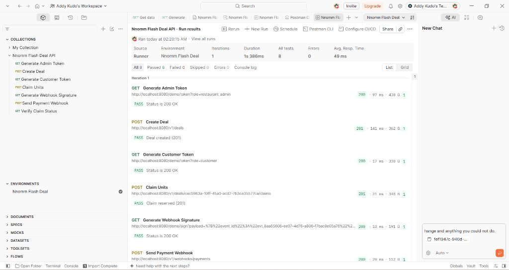
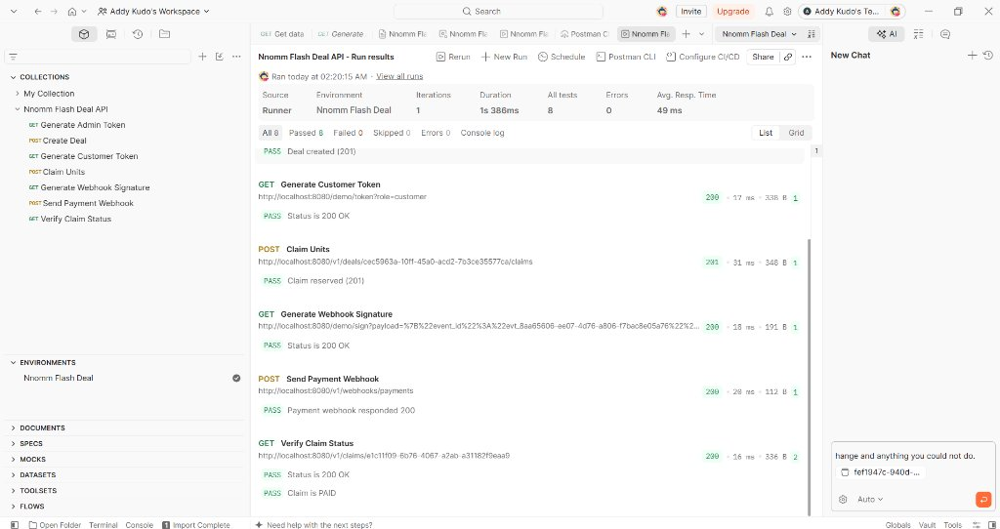

# Nnomm Flash-Deal Claim Service

A production-grade, highly concurrent flash-deal claim backend built for Nnomm using **Kotlin (JVM 21)**, **Ktor 3.x**, and **PostgreSQL 16**.

Designed to maintain strict data consistency, zero overselling, and idempotency guarantees under extreme load, running across multiple concurrent service instances sharing a single PostgreSQL database.

---

## Architecture Overview

```
                      +-----------------------------+
                      |   Reverse Proxy / Clients   |
                      +--------------+--------------+
                                     |
               +---------------------+---------------------+
               |                                           |
        [Port 8080]                                 [Port 8081]
+--------------v--------------+             +--------------v--------------+
|     Nnomm App Instance 1    |             |     Nnomm App Instance 2    |
| (Ktor + Netty + Coroutines) |             | (Ktor + Netty + Coroutines) |
+--------------+--------------+             +--------------+--------------+
               |                                           |
               +---------------------+---------------------+
                                     |
                      +--------------v--------------+
                      |     PostgreSQL 16 Cluster   |
                      |  - Row Locks (FOR UPDATE)   |
                      |  - Partial Unique Indexes   |
                      |  - SKIP LOCKED Batch Reaper |
                      +-----------------------------+
```

### Core Invariants Enforced at the Database Level
1. **Never Oversell**: 
   - `stock_available` never drops below 0 via `CONSTRAINT ck_deals_stock_available CHECK (stock_available >= 0)`.
   - `stock_available + active_units == stock_total` holds at every state transition.
   - Atomic reservation using `SELECT ... FOR UPDATE` row locks.
2. **One Active Claim Per Customer Per Deal**:
   - Enforced by PostgreSQL partial unique index:
     `CREATE UNIQUE INDEX idx_claims_active_per_customer_deal ON claims (deal_id, customer_id) WHERE status IN ('RESERVED', 'PAID', 'NEEDS_REVIEW');`
3. **Strict Idempotency**:
   - Scoped to `(customer_id, idempotency_key)`.
   - Matching parameters within 24h replay original response with header `Idempotent-Replayed: true`.
   - Conflicting parameters return `422 IDEMPOTENCY_KEY_REUSED`.
   - In-progress requests return `409 REQUEST_IN_PROGRESS`.
   - 60-second lease timeout ensures dead instances never deadlock retry attempts.
4. **Resilient Webhook Verification**:
   - HMAC-SHA256 signature verification over raw request bytes (`t.<raw_body>`).
   - Constant-time comparison (`MessageDigest.isEqual`) to eliminate timing attacks.
   - 300-second timestamp drift window protects against replay attacks.
   - Primary key on `processed_webhook_events(event_id)` for multi-instance deduplication.

---

## Quickstart: Running via Docker Compose

Run PostgreSQL and two independent service instances on ports `8080` and `8081` with one command:

```bash
docker compose up --build
```

### Service Endpoints
- **Instance 1**: `http://localhost:8080`
- **Instance 2**: `http://localhost:8081`
- **PostgreSQL**: `localhost:5432` (db: `nnomm`, user: `postgres`, pass: `postgrespassword`)

Health check:
```bash
curl http://localhost:8080/health
# {"status":"UP"}
```

---

## Running the Automated Test Suite

Run the full integration test suite against real PostgreSQL (via Testcontainers or configured `DATABASE_URL`):

```bash
./gradlew test
```

### Key Concurrency Test Scenarios Covered
1. **200 Concurrent Claims Race** (`ClaimConcurrencyTest.kt`): 200 distinct customers race for a 50-unit deal. Exactly 50 succeed (201), 150 receive `409 SOLD_OUT`, and available stock reaches exactly 0 with zero overselling.
2. **Same Customer Concurrency Race** (`ClaimConcurrencyTest.kt`): 20 concurrent claims from the same customer with different keys create exactly 1 claim; 19 fail with `409 ALREADY_CLAIMED`.
3. **Idempotency Key Concurrency Race** (`IdempotencyConcurrencyTest.kt`): 20 concurrent requests with the identical key produce exactly 1 creation; all others receive in-progress or replayed response.
4. **Payment vs. Expiry Millisecond Race** (`PaymentExpiryRaceTest.kt`): Concurrent payment webhook and background expiry reaper leave stock invariants 100% intact across repeated runs.
5. **Webhook Security & Tampering** (`WebhookSecurityTest.kt`): Verifies invalid signatures, stale timestamps (> 300s), duplicate events, and amount mismatch transitions.
6. **Authorization Boundaries** (`AuthorizationBoundaryTest.kt`): Verifies customer claim isolation and restaurant admin boundaries (returning 404 instead of 403).

---

## 🧪 End-to-End API Test Results (Postman)

All core transaction workflows and payment webhooks were verified using an automated Postman test collection with **100% pass rate (8/8 assertions, 0 errors)**:

| Step | Request Name | Method & Endpoint | Assertions | Result |
| :--- | :--- | :--- | :--- | :--- |
| **1** | **Generate Admin Token** | `GET /demo/token?role=restaurant_admin` | Status is 200 OK | ✅ PASS |
| **2** | **Create Deal** | `POST /v1/deals` | Deal created (201) | ✅ PASS |
| **3** | **Generate Customer Token** | `GET /demo/token?role=customer` | Status is 200 OK | ✅ PASS |
| **4** | **Claim Units** | `POST /v1/deals/{dealId}/claims` | Claim reserved (201) | ✅ PASS |
| **5** | **Generate Webhook Signature** | `GET /demo/sign?payload=...` | Status is 200 OK | ✅ PASS |
| **6** | **Send Payment Webhook** | `POST /v1/webhooks/payments` | Payment webhook responded 200 | ✅ PASS |
| **7** | **Verify Claim Status** | `GET /v1/claims/{claimId}` | Status is 200 OK & Claim is PAID | ✅ PASS |

### Test Run Execution Evidence

**Part 1: Authentication, Deal Creation & Unit Claiming**  


**Part 2: Webhook Signing, Payment Execution & Final PAID Verification**  


> 💡 The ready-to-run Postman collection and environment files are available in the [`/postman`](postman/) directory for instant one-click execution.

---

## API Reference & Quick Examples

### Minting a JWT Token (HS256)
All endpoints except `/v1/webhooks/payments` and `/health` require an `Authorization: Bearer <JWT>` header with claims `sub` (UUID), `role` (`customer` or `restaurant_admin`), and `restaurant_id` (for admins).

### 1. Create a Deal (Restaurant Admin)
```bash
POST /v1/deals
Authorization: Bearer <ADMIN_JWT>
Content-Type: application/json

{
  "title": "Chicken Biryani Box",
  "price_paise": 9900,
  "stock_total": 50,
  "starts_at": "2026-10-20T12:00:00Z",
  "ends_at": "2026-10-20T14:00:00Z"
}
```

### 2. Get Deal Details (Any Authenticated User)
```bash
GET /v1/deals/{dealId}
Authorization: Bearer <JWT>
```

### 3. Claim Deal Units (Customer Only)
```bash
POST /v1/deals/{dealId}/claims
Authorization: Bearer <CUSTOMER_JWT>
Idempotency-Key: 3f6b2c1e-8a2d-4b5c-9e7f-1a2b3c4d5e6f
Content-Type: application/json

{
  "quantity": 2
}
```

### 4. Get Claim Details (Owner Customer or Deal's Admin)
```bash
GET /v1/claims/{claimId}
Authorization: Bearer <JWT>
```

### 5. Payment Webhook (Signed by Payment Gateway)
```bash
POST /v1/webhooks/payments
X-Payment-Signature: t=1792497791,v1=a1b2c3d4...
Content-Type: application/json

{
  "event_id": "evt_8a1d7f2b",
  "type": "payment.succeeded",
  "claim_id": "9d40...",
  "amount_paise": 19800,
  "occurred_at": "2026-10-20T12:03:11Z"
}
```

---

## Assumptions & Design Decisions

Wherever the specification left operational choices open, the following principles were applied:
1. **Handling Unknown `claim_id` in Webhooks**:
   - If a payment event arrives with an unknown `claim_id`, we record the event into `processed_webhook_events` to prevent unbounded webhook retries from the payment provider, and return `404 NOT_FOUND` to indicate the resource does not exist in our system.
2. **Multiple Successful Payments for the Same Claim**:
   - If a subsequent `payment.succeeded` event with a new `event_id` arrives for a claim already `PAID`, `NEEDS_REVIEW`, or `REFUND_PENDING`, we record the event for financial auditing and return HTTP 200 with `ALREADY_SETTLED`. The claim status and units remain settled to prevent disruptive double-processing.
3. **Dynamic Expiry Representation**:
   - As required, from `expires_at` on, the API *never* presents a claim as `RESERVED`. If queried between expiration and the next reaper pass, `GET /v1/claims/{id}` dynamically returns status `EXPIRED`.
4. **Idempotency Expiry**:
   - Records older than 24 hours are eligible for reset so customers can reuse keys across separate promotional campaigns after 24 hours.

---

## What We'd Do Next With More Time

1. **Cursor-Based Pagination for Claims**:
   Implement `GET /v1/me/claims` using keyset pagination (`(created_at, id) < (cursor_timestamp, cursor_id)`) to guarantee stable pagination without skips or duplicates even as new claims are concurrently created.
2. **Distributed Leaky Bucket Rate Limiting**:
   Add a Redis token-bucket filter enforcing a 10 requests/minute per-customer limit across all instances.
3. **Observability & Metrics**:
   Expose `/metrics` with Prometheus counters and histograms tracking claim latency, lock contention duration, and webhook signature verification failures.
4. **Admin Claims Inspection**:
   Provide `GET /v1/deals/{dealId}/claims?status=RESERVED` with role-based filtering for restaurant owners.

---

## AI Tools Used & Rejected Suggestions

### Tools Used
- **Antigravity AI (Gemini 3.8 Flash)**: Used for scaffolding Kotlin/Ktor structures, authoring Flyway migration DDL, analyzing concurrency race sequences, and generating test fixtures.

### Rejected AI Suggestion & Rationale
- **Suggestion**: An AI tool initially suggested implementing distributed locks using Redis (Redlock) or Hazelcast to synchronize deal claiming before writing to PostgreSQL.
- **Why Rejected**: In an ACID relational architecture, introducing Redlock adds external network hops, failure modes (split-brain, Redis master failover clock drift), and creates two divergent sources of truth. Instead, utilizing PostgreSQL's native row-level write locks (`SELECT ... FOR UPDATE`) with `READ COMMITTED` and partial unique constraints enforces strict, deterministic concurrency control at the database engine level across all instances without operational complexity or synchronization drift.
